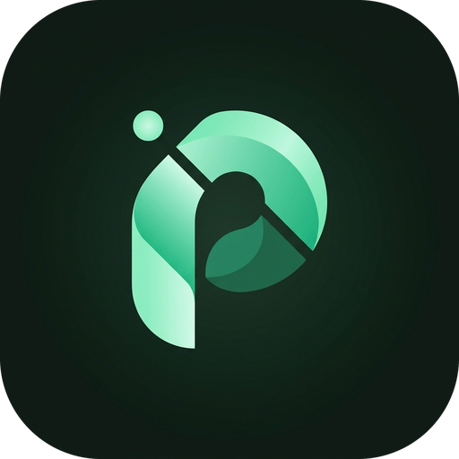
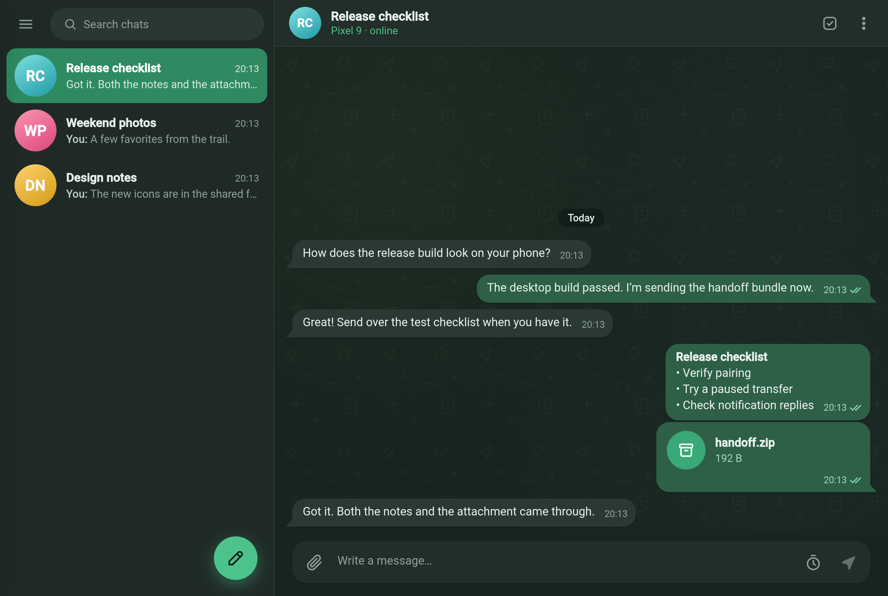

<p align="center">
  
</p>

# Portal Drop

Portal Drop sends messages and files directly between an Android phone and a Linux or Windows computer on the same local network. Pair once with a QR code, then use the chat on either device. Portal Drop uses your LAN without a cloud account or relay.

## Screenshots

| Desktop on Linux | Android |
| :---: | :---: |
|  |  |

Linux and Windows share the same desktop interface.

## Features

- Send text, Markdown, code blocks, and files. Large text stays in one conversation entry, and **Copy exact text** preserves the source formatting.
- Create and rename chats, reply to messages, page through older history, and delete selected items. Use the timer in the composer to send a temporary item that expires in Portal Drop after 10 minutes.
- Attach multiple files from a picker, drag files into the desktop window, or select Portal Drop in the Android Sharesheet. Android asks you to review attachments before sending.
- Track transfer progress and resume interrupted transfers. Portal Drop verifies each download with SHA-256 and organizes it under `Downloads/Portal Drop` by file type.
- Get incoming-message and file notifications while the app is in the background. Android supports inline notification replies.
- The desktop pushes queue changes to Android over an authenticated connection, so an available phone can start receiving without waiting for the next polling interval.

Portal Drop currently pairs **one Android phone with one computer** at a time.

## Install

Use the matching artifact from the GitHub release when available. If you prefer to compile it yourself, use the source instructions below.

### Linux

A release archive includes an installer. Extract `portal-drop-linux-x64.tar.gz` and run `./install.sh` from the extracted directory. The release binary is built on Ubuntu 24.04. Build from source if your distribution provides an older glibc.

For a source build, use Rust 1.88 or later, a C compiler, Python 3 with PyGObject, GTK 3, WebKitGTK 4.1 introspection, and a systemd user session. On Debian and Ubuntu, the desktop packages are `python3-gi`, `gir1.2-gtk-3.0`, and `gir1.2-webkit2-4.1`.

```sh
cargo build --locked --release --manifest-path linux/Cargo.toml
./linux/install.sh
```

The installer registers the desktop launcher and enables the user service at login. Open **Portal Drop** from your application menu.

### Windows

Extract `portal-drop-windows-x64.zip`, then run the installer from its folder in PowerShell. The desktop app requires the [Microsoft Edge WebView2 Runtime](https://developer.microsoft.com/en-us/microsoft-edge/webview2/).

```powershell
powershell -ExecutionPolicy Bypass -File .\install.ps1
```

Open **Portal Drop** from Start. To build locally, install the Rust MSVC toolchain and its C++ build tools, then run these commands from the repository root.

```powershell
cargo build --locked --release --manifest-path linux/Cargo.toml
cargo build --locked --release --manifest-path windows/Cargo.toml
Copy-Item linux/target/release/portal-drop.exe windows/
Copy-Item windows/target/release/portal-drop-desktop.exe windows/
powershell -ExecutionPolicy Bypass -File windows/install.ps1
```

Run `uninstall.ps1` from the release or source folder to remove the Windows installation.

### Android

Portal Drop supports Android 10 and later. Install the signed APK from a GitHub release if one is available. An in-place update needs the same signing certificate to retain chats and pairing.

To build a debug APK, use JDK 17 or later, Android SDK Platform 36, and Android SDK Platform-Tools. Set `ANDROID_HOME` or configure the SDK location in Android Studio.

```sh
./android/gradlew -p android assembleDebug
adb install -r android/app/build/outputs/apk/debug/app-debug.apk
```

## Pair and send

1. Connect both devices to the same local network. On desktop, open **Device → Pair Android**.
2. In Portal Drop on Android, scan the QR code or paste the pairing link. The invite expires after 10 minutes.
3. Tap **Pair & enable background** and allow notifications if you want new-message and download alerts.
4. Open a chat to send text or attach files. Use the background controls in **Device** to pause or resume the connection.

Portal Drop listens on TCP **53621** by default and uses multicast DNS on UDP **5353** for discovery. If the phone cannot connect, check the desktop firewall, guest-network client isolation, and the VPN's local-network settings. With multiple desktop interfaces, generate an invite using `portal-drop pair --address <LAN-IP>`. Android may defer transfers during deep idle. Open Portal Drop again after an Android force stop.

## Architecture

The Rust daemon owns the queue, SQLite history, TLS listener, and file storage on Linux and Windows. Linux hosts the shared desktop interface in GTK 3 and WebKitGTK. Windows hosts it in a native WebView2 window. The Android client uses Kotlin, SQLite, Android's Sharesheet, and a connected-device foreground service.

The invite pins the desktop TLS certificate. Android authenticates with a pairing token, and the desktop stores a hash of that token. The [protocol smoke tests](tests/protocol_smoke.py) cover version compatibility, event delivery, reconnects, offset resume, message integrity, paging, and revocation.

## Develop and verify

```sh
cargo fmt --manifest-path linux/Cargo.toml --check
cargo clippy --locked --manifest-path linux/Cargo.toml -- -D warnings
cargo build --locked --release --manifest-path linux/Cargo.toml
python3 tests/protocol_smoke.py linux/target/release/portal-drop
./android/gradlew -p android assembleDebug lintDebug
```

The desktop executable doubles as the CLI. Run `portal-drop --help` for pairing, queue, and history commands. Use `PORTAL_DROP_DATA_DIR` and `PORTAL_DROP_RECEIVE_DIR` to isolate development data from your normal installation.

For UI changes, test sending from the bottom of a chat and while reading older history. Check attachment confirmation, transfer progress, keyboard resize, and loading an older page.

## Release builds

The [release workflow](.github/workflows/release.yml) packages Linux and Windows for x86-64. A version tag such as `v0.3.0` creates a GitHub release with both desktop archives. The release includes an Android APK when signing is configured. Android release signing uses the repository secrets `PORTAL_KEYSTORE_BASE64`, `PORTAL_KEYSTORE_PASSWORD`, `PORTAL_KEY_ALIAS`, and `PORTAL_KEY_PASSWORD`. Keep local signing properties and keystores outside version control.
