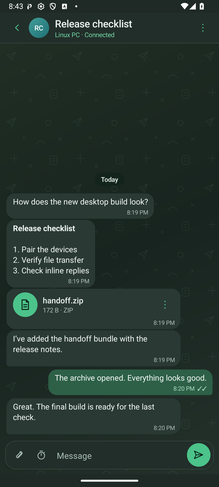

<p align="center">
  
</p>

<h1 align="center">Portal Drop</h1>

<p align="center">
  Direct LAN messaging and file transfer between Android, Linux, and Windows.<br>
  Pair once with a QR code. No cloud servers, no accounts, no cables.
</p>

<p align="center">
  <a href="https://github.com/shahriar-ahmed-seam/Portal-drop/releases/latest"></a>
  
  
</p>

---

## Screenshots

<table align="center">
  <tr>
    <th align="center">Desktop (Linux and Windows)</th>
    <th align="center">Android</th>
  </tr>
  <tr>
    <td align="center" valign="middle">
      
    </td>
    <td align="center" valign="middle">
      
    </td>
  </tr>
</table>

Linux and Windows share the same web-rendered desktop interface with Light, Dark, and System themes.

---

## Key Features

- **Direct LAN messaging**: Send plain text, Markdown formatting, and fenced code blocks with exact-text copy support. Large text payloads stay collapsed inside a single chat entry.
- **Fast resumable file transfers**: Attach multiple files via the native file chooser, drag and drop files directly onto the desktop window, or share from the Android Sharesheet with an attachment review step. Downloads resume automatically after interruptions, are verified with SHA-256, and are organized under `Downloads/Portal Drop`.
- **Instant push delivery**: The desktop daemon pushes queue updates to Android over an authenticated Server-Sent Events stream with HTTP/1.1 keep-alive reuse, eliminating polling lag in both directions.
- **Chat management**: Create, rename, and delete synchronized chats, reply inline to messages, page through older history, and batch-delete selected messages or files.
- **Temporary messages**: Arm the one-time timer in the composer to send a message or file that automatically expires from both devices after 10 minutes.
- **Background notifications and audio cues**: Receive system notifications with distinct chimes for incoming messages, completed file downloads, and device connections. Android supports direct inline notification replies and opening any received file type (including APK installation when permitted).

Portal Drop pairs one Android device with one desktop computer at a time.

---

## Download and Install

Prebuilt packages for Linux (`.deb`, `.tar.gz`), Windows (`.exe`, `.zip`), and Android (`.apk`) are published on the [GitHub Releases](https://github.com/shahriar-ahmed-seam/Portal-drop/releases) page.

### Linux (Debian / Ubuntu)

**Debian package (recommended)**

Download `portal-drop_0.3.0_amd64.deb` from the latest release and install it with `apt`:

```sh
sudo apt install ./portal-drop_0.3.0_amd64.deb
systemctl --user enable --now portal-drop.service
```

**Portable archive**

Extract `portal-drop-linux-x64.tar.gz` and run `./install.sh` from the extracted folder. Release binaries are built on Ubuntu 24.04; compile from source if your distribution ships an older `glibc`.

**Build from source**

Requires Rust 1.88+, a C compiler, Python 3 with PyGObject, GTK 3, WebKitGTK 4.1 (`python3-gi`, `gir1.2-gtk-3.0`, `gir1.2-webkit2-4.1`), and a `systemd --user` session.

```sh
cargo build --locked --release --manifest-path linux/Cargo.toml
./linux/install.sh
```

Launch **Portal Drop** from your application menu or run `portal-drop-desktop`.

### Windows

**Installer (recommended)**

Download and run `portal-drop-0.3.0-windows-x64-setup.exe` from the latest release. The installer installs Portal Drop per user under `%LOCALAPPDATA%\Portal Drop`, registers login autostart, and creates a Start Menu entry. Requires the [Microsoft Edge WebView2 Runtime](https://developer.microsoft.com/en-us/microsoft-edge/webview2/) (preinstalled on Windows 11 and most Windows 10 systems).

**Portable archive**

Extract `portal-drop-windows-x64.zip` and run:

```powershell
powershell -ExecutionPolicy Bypass -File .\install.ps1
```

To remove a script-based installation, run `uninstall.ps1` from the same folder.

**Build from source**

Requires the Rust MSVC toolchain and Visual Studio C++ Build Tools:

```powershell
cargo build --locked --release --manifest-path linux/Cargo.toml
cargo build --locked --release --manifest-path windows/Cargo.toml
Copy-Item linux/target/release/portal-drop.exe windows/
Copy-Item windows/target/release/portal-drop-desktop.exe windows/
powershell -ExecutionPolicy Bypass -File windows/install.ps1
```

### Android

Requires Android 10 (API 29) or later.

Download and install the signed `portal-drop-0.3.0-android.apk` from the latest release. Future releases signed with the same release certificate update in place while preserving chat history and pairing.

**Build from source**

Requires JDK 17+, Android SDK Platform 36, and Android SDK Platform-Tools:

```sh
./android/gradlew -p android assembleDebug
adb install -r android/app/build/outputs/apk/debug/app-debug.apk
```

---

## Quick Start and Pairing

1. Connect your desktop and Android phone to the same local Wi-Fi network.
2. Open **Portal Drop** on your desktop and click **Pair Android device** (or open the top-left **Menu > Pair Android device**).
3. Open **Portal Drop** on Android, scan the QR code or paste the single-use pairing link (expires after 10 minutes), and tap **Pair & enable background**.
4. Allow notification permission on Android if you want incoming message, file, and connection alerts.
5. Start sending messages, pasting snippets, or dragging files into the chat window. Pause or resume the background service anytime from the desktop **Menu**.

### Network Notes

- Portal Drop listens on **TCP 53621** by default and advertises itself via mDNS on **UDP 5353**.
- If the phone cannot reach the desktop, verify your desktop firewall rules, disable router client/AP isolation, and allow local-network traffic in any active VPN.
- On multi-homed hosts with multiple network interfaces, generate an invite targeting a specific interface with `portal-drop pair --address <LAN-IP>`.
- Android may pause background sync during extended Doze or after a manual Force Stop; reopening the app resumes the service immediately.

---

## Architecture and Security

| Component | Stack | Responsibilities |
| :--- | :--- | :--- |
| Core daemon and CLI (`linux/`) | Rust, Axum, Rustls, SQLite | TLS server, SSE event stream, SQLite WAL storage, resumable file staging, mDNS discovery, CLI |
| Shared desktop UI (`desktop-ui/`) | HTML, CSS, JavaScript | Unified Telegram-inspired chat interface shared by Linux and Windows with Light/Dark themes |
| Linux host (`linux/desktop/`) | Python, GTK 3, WebKitGTK 4.1 | Native window chrome, file dialog, drag-and-drop bridge, D-Bus notifications |
| Windows host (`windows/`) | Rust, tao, wry (WebView2) | Native Windows window, file dialog, drag-and-drop bridge, toast notifications |
| Android client (`android/`) | Kotlin, Android SDK, SQLite | Native dark-mode UI, Sharesheet integration, connected-device foreground service |

During pairing, the QR invite pins the desktop's self-signed TLS certificate SHA-256 fingerprint on Android. Subsequent API requests authenticate with a random bearer token whose hash is stored on the desktop. All message and file payloads stay strictly on your LAN.

---

## Development and Verification

Run formatting, static analysis, release compilation, protocol smoke tests, Debian packaging, and Android lint checks locally:

```sh
cargo fmt --manifest-path linux/Cargo.toml --check
cargo clippy --locked --manifest-path linux/Cargo.toml -- -D warnings
cargo build --locked --release --manifest-path linux/Cargo.toml
python3 tests/protocol_smoke.py linux/target/release/portal-drop
./linux/build-deb.sh
./android/gradlew -p android assembleDebug lintDebug
```

The core binary also serves as a full CLI (`portal-drop --help`). Set `PORTAL_DROP_DATA_DIR` and `PORTAL_DROP_RECEIVE_DIR` to isolate development runs from your personal data.

### Automated Releases

Pushing a version tag (such as `v0.3.0`) triggers [release.yml](.github/workflows/release.yml) to build and attach all release artifacts:

- Linux: `portal-drop_<version>_amd64.deb` and `portal-drop-linux-x64.tar.gz`
- Windows: `portal-drop-<version>-windows-x64-setup.exe` and `portal-drop-windows-x64.zip`
- Android: `portal-drop-<version>-android.apk` (signed when `PORTAL_KEYSTORE_BASE64`, `PORTAL_KEYSTORE_PASSWORD`, `PORTAL_KEY_ALIAS`, and `PORTAL_KEY_PASSWORD` repository secrets are configured)
